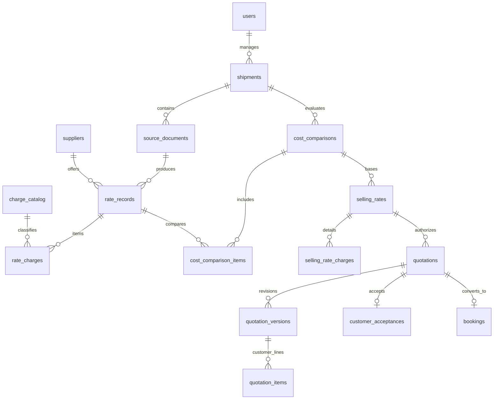

# Perkin FreightRate - Database Architecture & Schema Specification
**Version:** 2.0  
**Status:** DRAFT (Awaiting Company Data for TBD Items)  
**Database Engine:** PostgreSQL 15+ (Supabase)  
**ORM:** Drizzle ORM  
**Precision Rule:** All monetary amounts MUST use `numeric(18,4)`. Floating point (`real`, `double precision`) is strictly forbidden for financial calculations.

---

## 1. Schema Entity-Relationship Overview

---

## 2. Table Specifications

### 2.1 Core Identity & Security

#### Table: `users`
- **Purpose:** Extends Supabase Auth (`auth.users`) with application roles and profile metadata.
- **Columns:**
  | Column | Type | Nullable | Default | Description |
  |---|---|---|---|---|
  | `id` | `uuid` | No | - | PK. Foreign key to `auth.users(id)` ON DELETE CASCADE |
  | `email` | `text` | No | - | Staff email address (Unique) |
  | `full_name` | `text` | No | - | Staff display name |
  | `role` | `text` | No | `'sales_co'` | Role: `'admin'`, `'sales_co'`, `'sales_manager'`, `'management'` |
  | `is_active` | `boolean` | No | `true` | Account active flag |
  | `created_at` | `timestamptz` | No | `now()` | Record creation timestamp |
  | `updated_at` | `timestamptz` | No | `now()` | Record last updated timestamp |
- **Constraints & Indexes:**
  - `PRIMARY KEY (id)`
  - `UNIQUE (email)`
  - `CHECK (role IN ('admin', 'sales_co', 'sales_manager', 'management'))`

#### Table: `audit_logs`
- **Purpose:** Append-only ledger recording every state transition, mutation, and approval event.
- **Columns:**
  | Column | Type | Nullable | Default | Description |
  |---|---|---|---|---|
  | `id` | `uuid` | No | `gen_random_uuid()` | PK |
  | `entity_type` | `text` | No | - | e.g., `'rate_record'`, `'selling_rate'`, `'quotation'`, `'booking'` |
  | `entity_id` | `uuid` | No | - | Foreign ID of the entity modified |
  | `action` | `text` | No | - | e.g., `'CREATE'`, `'VERIFY'`, `'APPROVE'`, `'REVISE'`, `'SEND'` |
  | `actor_id` | `uuid` | No | - | FK to `users(id)` |
  | `previous_state` | `jsonb` | Yes | `null` | Pre-mutation snapshot |
  | `new_state` | `jsonb` | No | - | Post-mutation snapshot |
  | `reason` | `text` | Yes | `null` | Mandatory for overrides or rejections |
  | `ip_address` | `text` | Yes | `null` | Client IP |
  | `created_at` | `timestamptz` | No | `now()` | Immutable timestamp |
- **Constraints & Indexes:**
  - `PRIMARY KEY (id)`
  - `INDEX idx_audit_entity (entity_type, entity_id)`
  - `INDEX idx_audit_actor (actor_id)`
  - `INDEX idx_audit_created_at (created_at DESC)`

#### Table: `processing_jobs`
- **Purpose:** State machine tracking for asynchronous background tasks (AI extraction, document parsing).
- **Columns:**
  | Column | Type | Nullable | Default | Description |
  |---|---|---|---|---|
  | `id` | `uuid` | No | `gen_random_uuid()` | PK |
  | `job_type` | `text` | No | - | `'AI_EXTRACTION'`, `'PDF_RENDER'`, `'DOCUMENT_PARSE'` |
  | `status` | `text` | No | `'PENDING'` | `'PENDING'`, `'PROCESSING'`, `'COMPLETED'`, `'FAILED'` |
  | `idempotency_key` | `text` | No | - | Hash to prevent duplicate executions |
  | `payload` | `jsonb` | No | - | Input arguments |
  | `result` | `jsonb` | Yes | `null` | Output payload |
  | `attempts` | `integer` | No | `0` | Execution attempt counter |
  | `max_attempts` | `integer` | No | `3` | Maximum retry threshold |
  | `error_message` | `text` | Yes | `null` | Detailed error stack trace |
  | `created_at` | `timestamptz` | No | `now()` | Ingestion timestamp |
  | `updated_at` | `timestamptz` | No | `now()` | State change timestamp |
- **Constraints & Indexes:**
  - `PRIMARY KEY (id)`
  - `UNIQUE (idempotency_key)`
  - `INDEX idx_job_status (status, created_at)`

---

### 2.2 Data-Driven Reference Tables (TBD Adaptable)

#### Table: `charge_catalog`
- **Purpose:** Standard repository of freight charges, default tax rules (WHT/VAT), and comparison grouping attributes. Seeded with the 29 real-world subjects from Perkin Logistics' comparison template.
- **Columns:**
  | Column | Type | Nullable | Default | Description |
  |---|---|---|---|---|
  | `id` | `uuid` | No | `gen_random_uuid()` | PK |
  | `code` | `text` | No | - | Standard charge code (e.g., `'SEA_FREIGHT'`, `'40DV'`, `'20GP'`, `'PICKUP'`, `'DEST_THC'`, `'TRANS_40'`) |
  | `name_en` | `text` | No | - | Standard English display name |
  | `name_th` | `text` | No | - | Standard Thai display name |
  | `category` | `text` | No | `'Ocean'` | `'Ocean'`, `'Origin_Local'`, `'Dest_Port'`, `'TH_Local_Transport'`, `'Insurance_Misc'`, `'Other'` |
  | `default_wht_percent`| `numeric(5,2)` | No | `0.00` | Default Thai Withholding Tax % (e.g., `1.00` for Transport, `3.00` for Service) |
  | `default_vat_percent`| `numeric(5,2)` | No | `0.00` | Default VAT % (`7.00` for taxable domestic services, `0.00` exempt) |
  | `is_baseline_candidate`| `boolean` | No | `false` | True for common destination/shared charges (e.g., Insurance, Dest THC, EQPT Cleaning) |
  | `counts_toward_total`| `boolean` | No | `true` | Include in automated comparable total sum |
  | `required_for_comparison` | `boolean` | No | `false` | Must be present to consider comparison complete |
  | `display_order` | `integer` | No | `100` | UI sort ordering matching Perkin's comparison sheet |
  | `is_active` | `boolean` | No | `true` | Active flag |
- **Constraints & Indexes:**
  - `PRIMARY KEY (id)`
  - `UNIQUE (code)`
  - `CHECK (category IN ('Ocean', 'Origin_Local', 'Dest_Port', 'TH_Local_Transport', 'Insurance_Misc', 'Other'))`

#### Table: `charge_aliases`
- **Purpose:** Alias matching table for AI extraction mapping and disambiguation.
- **Columns:**
  | Column | Type | Nullable | Default | Description |
  |---|---|---|---|---|
  | `id` | `uuid` | No | `gen_random_uuid()` | PK |
  | `charge_catalog_id` | `uuid` | Yes | `null` | FK to `charge_catalog(id)`. Null if unmapped |
  | `alias_pattern` | `text` | No | - | Normalized raw phrase (e.g., `'O/F'`, `'OCEAN FREIGHT'`) |
  | `is_confirmed` | `boolean` | No | `false` | Confirmed by staff |
  | `created_by` | `uuid` | Yes | `null` | FK to `users(id)` |
  | `created_at` | `timestamptz` | No | `now()` | Timestamp |
- **Constraints & Indexes:**
  - `PRIMARY KEY (id)`
  - `UNIQUE (alias_pattern)`
  - `INDEX idx_alias_pattern (alias_pattern)`

#### Table: `charge_units`
- **Purpose:** Standard units of freight pricing and conversion formulas.
- **Columns:**
  | Column | Type | Nullable | Default | Description |
  |---|---|---|---|---|
  | `id` | `uuid` | No | `gen_random_uuid()` | PK |
  | `code` | `text` | No | - | e.g., `'PER_CONTAINER'`, `'PER_BL'`, `'PER_CBM'`, `'PER_SHIPMENT'` |
  | `name_en` | `text` | No | - | English description |
  | `name_th` | `text` | No | - | Thai description |
  | `unit_group` | `text` | No | `'CONTAINER'` | `'CONTAINER'`, `'SHIPMENT'`, `'VOLUME'`, `'WEIGHT'`, `'DOCUMENT'` |
  | `conversion_to_shipment_formula` | `text` | Yes | `null` | e.g., `'RATE * QUANTITY'` |
  | `is_active` | `boolean` | No | `true` | Active status |
- **Constraints & Indexes:**
  - `PRIMARY KEY (id)`
  - `UNIQUE (code)`

#### Table: `exchange_rates`
- **Purpose:** Approved exchange rates for currency conversion and cost comparisons.
- **Columns:**
  | Column | Type | Nullable | Default | Description |
  |---|---|---|---|---|
  | `id` | `uuid` | No | `gen_random_uuid()` | PK |
  | `from_currency` | `text` | No | - | ISO-4217 (e.g., `'USD'`, `'CNY'`, `'EUR'`) |
  | `to_currency` | `text` | No | `'THB'` | Target currency |
  | `rate` | `numeric(18,4)` | No | - | Conversion multiplier |
  | `source` | `text` | No | `'BOT'` | Source (e.g., `'Bank of Thailand'`, `'Customs'`, `'Internal'`) |
  | `effective_date` | `date` | No | - | Effective commercial date |
  | `created_by` | `uuid` | No | - | FK to `users(id)` |
  | `created_at` | `timestamptz` | No | `now()` | Timestamp |
- **Constraints & Indexes:**
  - `PRIMARY KEY (id)`
  - `UNIQUE (from_currency, to_currency, effective_date, source)`

#### Table: `pricing_rules`
- **Purpose:** Configurable corporate financial rules, optional margin gates, and approval thresholds. **Initial default: no auto-markup and no forced margin approval gate (Sales staff enter their own markup manually); configurable anytime when company defines policy.**
- **Columns:**
  | Column | Type | Nullable | Default | Description |
  |---|---|---|---|---|
  | `id` | `uuid` | No | `gen_random_uuid()` | PK |
  | `rule_key` | `text` | No | `'GLOBAL_DEFAULT'`| Config key |
  | `min_gross_margin_percent` | `numeric(5,2)` | Yes | `null` | Optional margin threshold for manager approval (`null` = disabled; TBD) |
  | `min_markup_percent` | `numeric(5,2)` | Yes | `null` | Optional minimum markup (`null` = disabled; Sales enters manually) |
  | `max_discount_percent` | `numeric(5,2)` | Yes | `null` | Optional max discount without approval (`null` = disabled; TBD) |
  | `require_margin_approval` | `boolean` | No | `false` | Master toggle for margin approval gate (`false` until company sets threshold) |
  | `default_vat_percent` | `numeric(5,2)` | No | `7.00` | Standard VAT rate in Thailand (toggleable per charge line) |
  | `allow_self_approval` | `boolean` | No | `false` | Maker-checker rule enforcement when approval is enabled |
  | `block_on_rate_expiry` | `boolean` | No | `true` | Block quote if validity exceeds supplier validity |
  | `is_active` | `boolean` | No | `true` | Active status |
- **Constraints & Indexes:**
  - `PRIMARY KEY (id)`
  - `UNIQUE (rule_key)`

---

### 2.3 Shipment & Rate Ingestion Domain

#### Table: `suppliers`
- **Purpose:** Directory of freight forwarders, shipping lines, and overseas co-loaders.
- **Columns:**
  | Column | Type | Nullable | Default | Description |
  |---|---|---|---|---|
  | `id` | `uuid` | No | `gen_random_uuid()` | PK |
  | `name` | `text` | No | - | Short trade name |
  | `company_name` | `text` | No | - | Registered corporate entity name |
  | `contact_person` | `text` | Yes | `null` | Primary sales contact |
  | `phone` | `text` | Yes | `null` | Phone / LINE contact |
  | `email` | `text` | Yes | `null` | Contact email (reference only) |
  | `country_code` | `text` | No | `'TH'` | ISO country code |
  | `address` | `text` | Yes | `null` | Physical office address |
  | `notes` | `text` | Yes | `null` | Internal notes |
  | `is_active` | `boolean` | No | `true` | Active status |
  | `created_at` | `timestamptz` | No | `now()` | Timestamp |
  | `updated_at` | `timestamptz` | No | `now()` | Timestamp |
- **Constraints & Indexes:**
  - `PRIMARY KEY (id)`
  - `INDEX idx_suppliers_active (is_active, name)`

#### Table: `shipments`
- **Purpose:** Central opportunity/inquiry record aggregating rates, comparisons, quotes, and bookings. Supports mixed container types via `shipment_containers`.
- **Columns:**
  | Column | Type | Nullable | Default | Description |
  |---|---|---|---|---|
  | `id` | `uuid` | No | `gen_random_uuid()` | PK |
  | `shipment_ref` | `text` | No | - | Unique system code (e.g., `'SHP-202611-0001'`) |
  | `customer_name` | `text` | No | - | Prospect or customer name |
  | `contact_person` | `text` | Yes | `null` | Inquirer contact |
  | `contact_phone` | `text` | Yes | `null` | Inquirer phone |
  | `contact_email` | `text` | Yes | `null` | Inquirer email |
  | `pol_port_code` | `text` | No | - | Port of Loading UN/LOCODE (e.g., `'USLAX'`, `'CNSHA'`) |
  | `pod_port_code` | `text` | No | - | Port of Discharge UN/LOCODE (e.g., `'THLCH'`, `'THBKK'`) |
  | `incoterm` | `text` | Yes | `null` | e.g., `'EXW'`, `'FOB'`, `'CIF'`, `'DDP'` (determines required scope groups) |
  | `commodity_description`| `text` | Yes | `null` | Description of cargo |
  | `target_etd` | `date` | Yes | `null` | Customer target departure date |
  | `assigned_user_id` | `uuid` | No | - | FK to `users(id)` (Sales Co.) |
  | `created_at` | `timestamptz` | No | `now()` | Timestamp |
  | `updated_at` | `timestamptz` | No | `now()` | Timestamp |
- **Constraints & Indexes:**
  - `PRIMARY KEY (id)`
  - `UNIQUE (shipment_ref)`
  - `INDEX idx_shipment_assigned (assigned_user_id)`

#### Table: `shipment_containers`
- **Purpose:** Supports multiple container sizes/types within a single shipment inquiry (e.g., `1x40 DV` + `1x20 GP`).
- **Columns:**
  | Column | Type | Nullable | Default | Description |
  |---|---|---|---|---|
  | `id` | `uuid` | No | `gen_random_uuid()` | PK |
  | `shipment_id` | `uuid` | No | - | FK to `shipments(id)` ON DELETE CASCADE |
  | `container_type` | `text` | No | - | e.g., `'40DV'`, `'20GP'`, `'40HQ'`, `'20RF'` |
  | `quantity` | `integer` | No | `1` | Number of containers of this type |
  | `weight_kg_per_cntr` | `numeric(12,2)` | Yes | `null` | Gross weight per container (flags Overweight / Tri-axle rules) |
- **Constraints & Indexes:**
  - `PRIMARY KEY (id)`
  - `UNIQUE (shipment_id, container_type)`
  - `CHECK (quantity > 0)`

#### Table: `shipment_baseline_charges`
- **Purpose:** Shared/common shipment costs applied uniformly across all compared suppliers (e.g., Insurance, Destination THC, Dest Doc Fee, Equipment Cleaning, CIS/CIC) to eliminate repetitive entry.
- **Columns:**
  | Column | Type | Nullable | Default | Description |
  |---|---|---|---|---|
  | `id` | `uuid` | No | `gen_random_uuid()` | PK |
  | `shipment_id` | `uuid` | No | - | FK to `shipments(id)` ON DELETE CASCADE |
  | `charge_catalog_id` | `uuid` | No | - | FK to `charge_catalog(id)` |
  | `amount_thb` | `numeric(18,4)` | Yes | `null` | Native or converted THB amount |
  | `amount_usd` | `numeric(18,4)` | Yes | `null` | Native USD amount (if applicable) |
  | `wht_percent` | `numeric(5,2)` | No | `0.00` | WHT % |
  | `wht_amount` | `numeric(18,4)` | No | `0.0000` | Computed WHT |
  | `vat_percent` | `numeric(5,2)` | No | `0.00` | VAT % |
  | `vat_amount` | `numeric(18,4)` | No | `0.0000` | Computed VAT |
  | `notes` | `text` | Yes | `null` | Tariff reference or baseline rationale |
  | `created_by` | `uuid` | No | - | FK to `users(id)` |
  | `created_at` | `timestamptz` | No | `now()` | Timestamp |
- **Constraints & Indexes:**
  - `PRIMARY KEY (id)`
  - `UNIQUE (shipment_id, charge_catalog_id)`

#### Table: `source_documents`
- **Purpose:** Uploaded rate sheets, screenshots, or pasted text artifacts.
- **Columns:**
  | Column | Type | Nullable | Default | Description |
  |---|---|---|---|---|
  | `id` | `uuid` | No | `gen_random_uuid()` | PK |
  | `shipment_id` | `uuid` | No | - | FK to `shipments(id)` ON DELETE CASCADE |
  | `supplier_id` | `uuid` | Yes | `null` | FK to `suppliers(id)` if identified early |
  | `file_name` | `text` | No | - | Original uploaded file name |
  | `file_type` | `text` | No | - | `'IMAGE'`, `'PDF'`, `'PASTED_TEXT'` |
  | `mime_type` | `text` | No | - | e.g., `'application/pdf'`, `'image/png'`, `'text/plain'` |
  | `file_size` | `integer` | Yes | `null` | Size in bytes |
  | `storage_path` | `text` | Yes | `null` | Supabase Storage private path |
  | `file_hash_sha256` | `text` | No | - | SHA-256 hash for duplicate detection |
  | `raw_text_content` | `text` | Yes | `null` | Extracted digital text or pasted chat string |
  | `extraction_status`| `text` | No | `'Uploaded'` | `'Uploaded'`, `'Processing'`, `'Extracted'`, `'Failed'` |
  | `created_by` | `uuid` | No | - | FK to `users(id)` |
  | `created_at` | `timestamptz` | No | `now()` | Timestamp |
- **Constraints & Indexes:**
  - `PRIMARY KEY (id)`
  - `INDEX idx_doc_shipment (shipment_id)`
  - `INDEX idx_doc_hash (file_hash_sha256)`

#### Table: `rate_records`
- **Purpose:** Ingested supplier quotation draft and verified commercial rate record.
- **Columns:**
  | Column | Type | Nullable | Default | Description |
  |---|---|---|---|---|
  | `id` | `uuid` | No | `gen_random_uuid()` | PK |
  | `shipment_id` | `uuid` | No | - | FK to `shipments(id)` ON DELETE CASCADE |
  | `source_document_id`| `uuid`| No | - | FK to `source_documents(id)` |
  | `supplier_id` | `uuid` | No | - | FK to `suppliers(id)` |
  | `shipping_line_name`| `text` | Yes | `null` | Operating carrier name |
  | `rate_ref` | `text` | Yes | `null` | Supplier reference/quotation number |
  | `pol_port_code` | `text` | No | - | Loading port UN/LOCODE |
  | `pod_port_code` | `text` | No | - | Discharge port UN/LOCODE |
  | `container_type` | `text` | No | - | Container type code |
  | `quantity` | `integer` | No | `1` | Container quantity |
  | `service_type` | `text` | No | `'CY/CY'` | Service type (TBD) |
  | `transit_time_days` | `integer` | Yes | `null` | Estimated transit duration |
  | `free_time_demurrage_days`| `integer`| Yes | `null` | Port demurrage free days |
  | `free_time_detention_days`| `integer`| Yes | `null` | Container detention free days |
  | `payment_terms` | `text` | No | `'Prepaid'` | `'Prepaid'`, `'Collect'` |
  | `valid_from` | `date` | Yes | `null` | Rate validity start date |
  | `valid_to` | `date` | No | - | Rate expiration date |
  | `verification_status`| `text`| No | `'Awaiting_Verification'` | `'Awaiting_Verification'`, `'Verified'`, `'Rejected'`, `'Expired'`, `'Superseded'` |
  | `raw_ai_output` | `jsonb` | Yes | `null` | Immutable untouched AI JSON output |
  | `verified_by` | `uuid` | Yes | `null` | FK to `users(id)` |
  | `verified_at` | `timestamptz` | Yes | `null` | Verification timestamp |
  | `version` | `integer` | No | `1` | Rate revision version |
  | `created_at` | `timestamptz` | No | `now()` | Timestamp |
  | `updated_at` | `timestamptz` | No | `now()` | Timestamp |
- **Constraints & Indexes:**
  - `PRIMARY KEY (id)`
  - `INDEX idx_rate_shipment (shipment_id, verification_status)`
  - `INDEX idx_rate_supplier (supplier_id)`

#### Table: `rate_charges`
- **Purpose:** Detailed itemized charges (Ocean freight, origin drayage, destination port fees, Thailand local transport) per rate record, with explicit cell state, dual-currency, and Thai tax (WHT & VAT) tracking.
- **Columns:**
  | Column | Type | Nullable | Default | Description |
  |---|---|---|---|---|
  | `id` | `uuid` | No | `gen_random_uuid()` | PK |
  | `rate_record_id` | `uuid` | No | - | FK to `rate_records(id)` ON DELETE CASCADE |
  | `charge_catalog_id`| `uuid`| Yes | `null` | FK to `charge_catalog(id)`. Null if unmapped |
  | `raw_charge_name` | `text` | No | - | Verbatim string extracted from document |
  | `category` | `text` | No | `'Other'` | Category designation |
  | `container_type_ref`| `text`| Yes | `null` | Specific container type if applicable (e.g., `'40DV'`, `'20GP'`) |
  | `cell_status` | `text` | No | `'QUOTED'` | `'QUOTED'`, `'NOT_APPLICABLE'` (`-`), `'INCLUDED'`, `'MISSING'` |
  | `amount` | `numeric(18,4)` | Yes | `null` | Original buying cost amount in native currency (`null` if N/A or Missing) |
  | `currency` | `text` | Yes | `null` | Native ISO-4217 Currency (e.g., `'USD'`, `'THB'`) |
  | `amount_usd` | `numeric(18,4)` | Yes | `null` | USD amount (populated if USD-denominated) |
  | `amount_thb` | `numeric(18,4)` | Yes | `null` | Native THB or converted THB amount (with documented rounding) |
  | `fx_rate_used` | `numeric(18,4)` | Yes | `null` | Exchange rate snapshot used to compute `amount_thb` |
  | `wht_percent` | `numeric(5,2)` | No | `0.00` | Withholding Tax % (e.g., `1.00` on domestic transport, `3.00` on services) |
  | `wht_amount` | `numeric(18,4)` | No | `0.0000` | Computed WHT amount in THB (e.g., `55.00` on `5,500.00`) |
  | `vat_percent` | `numeric(5,2)` | No | `0.00` | VAT % (e.g., `7.00` or `0.00` exempt) |
  | `vat_amount` | `numeric(18,4)` | No | `0.0000` | Computed VAT amount in THB |
  | `charge_unit` | `text` | No | - | e.g., `'PER_CONTAINER'`, `'PER_BL'`, `'PER_HBL'`, `'PER_DAY'`, `'PER_SHIPMENT'` |
  | `is_included` | `boolean` | No | `false` | Explicitly marked as included in Ocean Freight |
  | `is_excluded` | `boolean` | No | `false` | Explicitly marked as excluded / collect |
  | `source_page` | `integer` | Yes | `null` | Source PDF or image page index |
  | `source_text_snippet`| `text`| Yes | `null` | Bounding text snippet for traceability |
  | `confidence_score`| `numeric(4,3)` | Yes | `null` | AI model extraction confidence ($0.000 - 1.000$) |
  | `is_verified` | `boolean` | No | `false` | Checked by human staff |
  | `created_at` | `timestamptz` | No | `now()` | Timestamp |
- **Constraints & Indexes:**
  - `PRIMARY KEY (id)`
  - `CHECK (cell_status IN ('QUOTED', 'NOT_APPLICABLE', 'INCLUDED', 'MISSING'))`
  - `INDEX idx_charge_rate (rate_record_id)`
  - `INDEX idx_charge_catalog (charge_catalog_id)`

---

### 2.4 Cost Comparison & Evaluation Domain

#### Table: `cost_comparisons`
- **Purpose:** Comparison session linking 2 to 5 verified rates and tracking human supplier selection.
- **Columns:**
  | Column | Type | Nullable | Default | Description |
  |---|---|---|---|---|
  | `id` | `uuid` | No | `gen_random_uuid()` | PK |
  | `shipment_id` | `uuid` | No | - | FK to `shipments(id)` ON DELETE CASCADE |
  | `status` | `text` | No | `'Open'` | `'Open'`, `'Supplier_Selected'`, `'Needs_Review'` |
  | `selected_rate_record_id`| `uuid`| Yes| `null` | FK to `rate_records(id)` (Winning supplier) |
  | `selected_by` | `uuid` | Yes | `null` | FK to `users(id)` |
  | `selected_at` | `timestamptz` | Yes | `null` | Timestamp of human selection |
  | `selection_reason` | `text` | Yes | `null` | Commercial rationale (e.g., fastest transit time) |
  | `comparison_notes` | `text` | Yes | `null` | Internal comparison notes |
  | `is_active` | `boolean` | No | `true` | Active comparison for this shipment |
  | `created_at` | `timestamptz` | No | `now()` | Timestamp |
  | `updated_at` | `timestamptz` | No | `now()` | Timestamp |
- **Constraints & Indexes:**
  - `PRIMARY KEY (id)`
  - `INDEX idx_comp_shipment (shipment_id, is_active)`

#### Table: `cost_comparison_items`
- **Purpose:** Individual rates evaluated inside a comparison session with section subtotals, dual-currency totals, tax totals (WHT/VAT), and scope completeness evaluation.
- **Columns:**
  | Column | Type | Nullable | Default | Description |
  |---|---|---|---|---|
  | `id` | `uuid` | No | `gen_random_uuid()` | PK |
  | `cost_comparison_id`| `uuid`| No | - | FK to `cost_comparisons(id)` ON DELETE CASCADE |
  | `rate_record_id` | `uuid` | No | - | FK to `rate_records(id)` |
  | `is_selected` | `boolean` | No | `false` | Flag indicating winning choice |
  | `total_ocean_freight_thb`| `numeric(18,4)` | Yes | `null` | Ocean & marine surcharges subtotal (THB) |
  | `total_origin_charges_thb`| `numeric(18,4)` | Yes | `null` | Origin pickup / drayage / overseas local subtotal (THB) |
  | `total_dest_port_thb` | `numeric(18,4)` | Yes | `null` | Destination port charges subtotal (THB) |
  | `total_th_local_thb` | `numeric(18,4)` | Yes | `null` | Thailand clearance, handling & transport subtotal (THB) |
  | `total_wht_thb` | `numeric(18,4)` | No | `0.0000` | Sum of Withholding Tax across all lines (THB) |
  | `total_vat_thb` | `numeric(18,4)` | No | `0.0000` | Sum of VAT across all lines (THB) |
  | `total_amount_usd` | `numeric(18,4)` | Yes | `null` | Sum of USD-denominated charges (USD) |
  | `total_comparable_cost_thb`| `numeric(18,4)`| Yes | `null` | Grand total THB (only highlighted if `is_fully_comparable = true`) |
  | `is_fully_comparable` | `boolean` | No | `false` | True if zero missing mandatory sections for shipment Incoterm |
  | `scope_completeness_json`| `jsonb` | No | `'{}'` | Per-group status map (e.g., `{"Ocean":"MISSING","Origin_Local":"COMPLETE"}`) |
  | `comparability_notes` | `text` | Yes | `null` | Explicit warning list (e.g., "Missing Ocean Freight & TH Transport") |
  | `created_at` | `timestamptz` | No | `now()` | Timestamp |
- **Constraints & Indexes:**
  - `PRIMARY KEY (id)`
  - `UNIQUE (cost_comparison_id, rate_record_id)`

---

### 2.5 Selling Rate & Pricing Domain (Confidential)

#### Table: `selling_rates`
- **Purpose:** Stores internal pricing calculation, markup formulas, gross profit, and manager approval status.
- **Columns:**
  | Column | Type | Nullable | Default | Description |
  |---|---|---|---|---|
  | `id` | `uuid` | No | `gen_random_uuid()` | PK |
  | `shipment_id` | `uuid` | No | - | FK to `shipments(id)` ON DELETE CASCADE |
  | `cost_comparison_id` | `uuid` | No | - | FK to `cost_comparisons(id)` |
  | `selected_rate_record_id`| `uuid`| No | - | FK to `rate_records(id)` |
  | `currency` | `text` | No | `'THB'` | Quotation billing currency |
  | `status` | `text` | No | `'Draft'` | `'Draft'`, `'Pending_Approval'`, `'Approved'`, `'Returned'`, `'Needs_Review'` |
  | `markup_type` | `text` | No | `'PERCENTAGE'` | `'PERCENTAGE'`, `'FIXED_AMOUNT'`, `'CUSTOM'` |
  | `markup_value` | `numeric(18,4)` | No | `0.0000` | Markup % or fixed amount per unit |
  | `base_cost_amount` | `numeric(18,4)` | No | - | Buying cost converted to billing currency |
  | `additional_internal_cost`| `numeric(18,4)`| No | `0.0000` | Internal expenses (trucking, brokerage) |
  | `total_selling_price`| `numeric(18,4)`| No | - | Commercial selling price before VAT & discount |
  | `discount_amount` | `numeric(18,4)` | No | `0.0000` | Commercial discount |
  | `gross_profit` | `numeric(18,4)` | No | - | Selling price (excl. VAT) - Total Cost |
  | `markup_percent` | `numeric(7,4)` | No | - | Computed markup % |
  | `gross_margin_percent`| `numeric(7,4)` | No | - | Computed gross margin % |
  | `vat_percent` | `numeric(5,2)` | No | `7.00` | Configurable VAT % |
  | `vat_amount` | `numeric(18,4)` | No | `0.0000` | Calculated VAT amount |
  | `grand_total_selling`| `numeric(18,4)`| No | - | Final price payable by customer |
  | `snapshot_data` | `jsonb` | Yes | `null` | Frozen snapshot of cost items and FX rates |
  | `approval_requested_at`| `timestamptz` | Yes | `null` | Timestamp when submitted to manager |
  | `approved_by` | `uuid` | Yes | `null` | FK to `users(id)` |
  | `approved_at` | `timestamptz` | Yes | `null` | Timestamp of manager approval |
  | `rejection_reason` | `text` | Yes | `null` | Rationale if returned by manager |
  | `created_by` | `uuid` | No | - | FK to `users(id)` |
  | `created_at` | `timestamptz` | No | `now()` | Timestamp |
  | `updated_at` | `timestamptz` | No | `now()` | Timestamp |
- **Constraints & Indexes:**
  - `PRIMARY KEY (id)`
  - `INDEX idx_selling_shipment (shipment_id, status)`

#### Table: `selling_rate_charges`
- **Purpose:** Line-by-line internal cost vs. selling rate breakdown.
- **Columns:**
  | Column | Type | Nullable | Default | Description |
  |---|---|---|---|---|
  | `id` | `uuid` | No | `gen_random_uuid()` | PK |
  | `selling_rate_id` | `uuid` | No | - | FK to `selling_rates(id)` ON DELETE CASCADE |
  | `charge_catalog_id`| `uuid`| Yes | `null` | FK to `charge_catalog(id)` |
  | `description` | `text` | No | - | Line description |
  | `cost_amount` | `numeric(18,4)` | No | - | Buying cost |
  | `selling_amount` | `numeric(18,4)` | No | - | Quoted customer amount |
  | `currency` | `text` | No | - | Currency code |
  | `charge_unit` | `text` | No | - | Pricing unit |
  | `is_vat_applicable`| `boolean`| No | `true` | Taxable charge flag |
  | `created_at` | `timestamptz` | No | `now()` | Timestamp |
- **Constraints & Indexes:**
  - `PRIMARY KEY (id)`
  - `INDEX idx_sell_charge_rate (selling_rate_id)`

---

### 2.6 Customer Quotation Domain (Isolated Customer-Facing Boundary)

#### Table: `quotations`
- **Purpose:** Customer quotation master header. Contains NO supplier or internal cost fields.
- **Columns:**
  | Column | Type | Nullable | Default | Description |
  |---|---|---|---|---|
  | `id` | `uuid` | No | `gen_random_uuid()` | PK |
  | `shipment_id` | `uuid` | No | - | FK to `shipments(id)` ON DELETE CASCADE |
  | `selling_rate_id` | `uuid` | No | - | FK to `selling_rates(id)` |
  | `quotation_number` | `text` | No | - | Unique business ID (e.g., `'PK-QT-202611-0001'`) |
  | `current_version` | `integer` | No | `1` | Active version number |
  | `status` | `text` | No | `'Draft'` | `'Draft'`, `'Pending_Approval'`, `'Approved'`, `'Sent'`, `'Waiting_for_Customer'`, `'Accepted'`, `'Rejected'`, `'Revision_Requested'`, `'Expired'`, `'Cancelled'` |
  | `customer_name` | `text` | No | - | Customer company name |
  | `customer_contact`| `text` | Yes | `null` | Customer representative |
  | `customer_email` | `text` | Yes | `null` | Customer email |
  | `customer_phone` | `text` | Yes | `null` | Customer phone |
  | `customer_address`| `text` | Yes | `null` | Customer physical address |
  | `pol_port_code` | `text` | No | - | Port of Loading UN/LOCODE |
  | `pod_port_code` | `text` | No | - | Port of Discharge UN/LOCODE |
  | `container_type` | `text` | No | - | Container specification |
  | `quantity` | `integer` | No | `1` | Container quantity |
  | `commodity_description`| `text` | Yes | `null` | Cargo description |
  | `transit_time_text`| `text` | Yes | `null` | Customer-facing transit expectation |
  | `free_time_text` | `text` | Yes | `null` | Demurrage / detention allowance |
  | `service_type` | `text` | No | `'CY/CY'` | Service type (TBD) |
  | `payment_terms` | `text` | No | `'Prepaid'` | Commercial payment terms |
  | `valid_until` | `date` | No | - | Expiration date of quotation |
  | `terms_and_conditions`| `text`| Yes| `null` | Legal terms & conditions (Thai/English) |
  | `remarks` | `text` | Yes | `null` | Customer-visible remarks |
  | `assigned_sales_rep_id`| `uuid`| No | - | FK to `users(id)` |
  | `sent_at` | `timestamptz` | Yes | `null` | Timestamp when staff sent quotation |
  | `sent_channel` | `text` | Yes | `null` | Channel: `'EMAIL'`, `'LINE'`, `'HAND_DELIVERY'` |
  | `sent_by` | `uuid` | Yes | `null` | Staff member who transmitted quote |
  | `created_at` | `timestamptz` | No | `now()` | Timestamp |
  | `updated_at` | `timestamptz` | No | `now()` | Timestamp |
- **Constraints & Indexes:**
  - `PRIMARY KEY (id)`
  - `UNIQUE (quotation_number)`
  - `INDEX idx_quote_shipment (shipment_id)`
  - `INDEX idx_quote_status (status)`

#### Table: `quotation_versions`
- **Purpose:** Immutable audit snapshot of every quotation revision sent or presented.
- **Columns:**
  | Column | Type | Nullable | Default | Description |
  |---|---|---|---|---|
  | `id` | `uuid` | No | `gen_random_uuid()` | PK |
  | `quotation_id` | `uuid` | No | - | FK to `quotations(id)` ON DELETE CASCADE |
  | `version_number` | `integer` | No | `1` | Sequential revision index ($1, 2, 3 \dots$) |
  | `status` | `text` | No | `'Draft'` | Status of this specific revision |
  | `subtotal` | `numeric(18,4)` | No | - | Sum of customer line items |
  | `discount_amount` | `numeric(18,4)` | No | `0.0000` | Commercial discount |
  | `vat_amount` | `numeric(18,4)` | No | `0.0000` | VAT amount |
  | `grand_total` | `numeric(18,4)` | No | - | Final quotation sum |
  | `currency` | `text` | No | `'THB'` | Currency code |
  | `snapshot_payload`| `jsonb` | No | - | Full immutable customer JSON snapshot |
  | `change_summary` | `text` | Yes | `null` | Staff notes describing revision changes |
  | `created_by` | `uuid` | No | - | FK to `users(id)` |
  | `created_at` | `timestamptz` | No | `now()` | Timestamp |
- **Constraints & Indexes:**
  - `PRIMARY KEY (id)`
  - `UNIQUE (quotation_id, version_number)`

#### Table: `quotation_items`
- **Purpose:** Customer-facing line items. Strictly sanitized; zero supplier cost data.
- **Columns:**
  | Column | Type | Nullable | Default | Description |
  |---|---|---|---|---|
  | `id` | `uuid` | No | `gen_random_uuid()` | PK |
  | `quotation_version_id`| `uuid`| No | - | FK to `quotation_versions(id)` ON DELETE CASCADE |
  | `item_order` | `integer` | No | `1` | Display order in PDF and UI |
  | `description_en` | `text` | No | - | English description |
  | `description_th` | `text` | Yes | `null` | Thai description |
  | `quantity` | `numeric(12,2)` | No | `1.00` | Billed quantity |
  | `charge_unit_text`| `text` | No | - | Display unit (e.g., `'Per 40HQ'`, `'Per BL'`) |
  | `unit_price` | `numeric(18,4)` | No | - | Customer selling unit price |
  | `total_amount` | `numeric(18,4)` | No | - | Computed amount (`quantity * unit_price`) |
  | `currency` | `text` | No | `'THB'` | Currency code |
  | `is_taxable` | `boolean` | No | `true` | Subject to VAT |
  | `created_at` | `timestamptz` | No | `now()` | Timestamp |
- **Constraints & Indexes:**
  - `PRIMARY KEY (id)`
  - `INDEX idx_quote_items_ver (quotation_version_id, item_order)`

---

### 2.7 Acceptance & Internal Booking Handover

#### Table: `customer_acceptances`
- **Purpose:** Formal commercial acceptance record submitted before booking handover.
- **Columns:**
  | Column | Type | Nullable | Default | Description |
  |---|---|---|---|---|
  | `id` | `uuid` | No | `gen_random_uuid()` | PK |
  | `quotation_id` | `uuid` | No | - | FK to `quotations(id)` ON DELETE CASCADE |
  | `quotation_version_id`| `uuid`| No | - | FK to `quotation_versions(id)` (Exact version accepted) |
  | `decision` | `text` | No | `'Accepted'` | `'Accepted'`, `'Rejected'`, `'Revision_Requested'` |
  | `decision_date` | `date` | No | - | Date customer confirmed agreement |
  | `customer_signer_name`| `text`| Yes | `null` | Name of customer representative |
  | `customer_po_number`| `text` | Yes | `null` | Customer Purchase Order number |
  | `remarks` | `text` | Yes | `null` | Customer feedback notes |
  | `proof_attachment_path`| `text`| Yes | `null` | Supabase Storage path for signed quote / PO |
  | `recorded_by` | `uuid` | No | - | FK to `users(id)` |
  | `created_at` | `timestamptz` | No | `now()` | Timestamp |
- **Constraints & Indexes:**
  - `PRIMARY KEY (id)`
  - `INDEX idx_acceptance_quote (quotation_id)`

#### Table: `bookings`
- **Purpose:** Operational freight booking generated seamlessly from an accepted quotation.
- **Columns:**
  | Column | Type | Nullable | Default | Description |
  |---|---|---|---|---|
  | `id` | `uuid` | No | `gen_random_uuid()` | PK |
  | `booking_number` | `text` | No | - | Unique system code (e.g., `'PK-BK-202611-0001'`) |
  | `shipment_id` | `uuid` | No | - | FK to `shipments(id)` |
  | `quotation_id` | `uuid` | No | - | FK to `quotations(id)` (Strictly 1:1) |
  | `quotation_version_id`| `uuid`| No | - | FK to `quotation_versions(id)` |
  | `carrier_booking_ref`| `text` | Yes | `null` | Shipping line booking confirmation number |
  | `shipping_line_name`| `text` | Yes | `null` | Operating ocean carrier |
  | `vessel_name` | `text` | Yes | `null` | Operating vessel |
  | `voyage_number` | `text` | Yes | `null` | Voyage identifier |
  | `etd` | `date` | Yes | `null` | Estimated departure date |
  | `eta` | `date` | Yes | `null` | Estimated arrival date |
  | `cargo_closing_date`| `timestamptz`| Yes | `null` | Port closing deadline |
  | `status` | `text` | No | `'Created'` | `'Created'`, `'Cancelled'` |
  | `operational_notes`| `text` | Yes | `null` | Handover instructions to operations |
  | `booking_snapshot` | `jsonb` | No | - | Immutable snapshot of all commercial & cost data |
  | `created_by` | `uuid` | No | - | FK to `users(id)` |
  | `created_at` | `timestamptz` | No | `now()` | Timestamp |
  | `updated_at` | `timestamptz` | No | `now()` | Timestamp |
- **Constraints & Indexes:**
  - `PRIMARY KEY (id)`
  - `UNIQUE (booking_number)`
  - `UNIQUE (quotation_id)` -- Prevents duplicate booking creation!
  - `INDEX idx_booking_shipment (shipment_id)`

---

## 3. Row-Level Security (RLS) Policy Specifications

### Policy Group 1: Internal Cost and Profit Visibility (Confidentiality)
- **Target Tables:** `rate_records`, `rate_charges`, `cost_comparisons`, `cost_comparison_items`, `selling_rates`, `selling_rate_charges`.
- **Policy Rule:**
  - `admin`, `sales_manager`, and `management` have `SELECT`, `INSERT`, `UPDATE` access.
  - `sales_co` has `SELECT`, `INSERT`, `UPDATE` access ONLY on shipments assigned to them (`shipments.assigned_user_id = auth.uid()`).
  - Unauthenticated requests or unauthorized roles receive `0` rows.

### Policy Group 2: Customer Quotation Access
- **Target Tables:** `quotations`, `quotation_versions`, `quotation_items`, `customer_acceptances`, `bookings`.
- **Policy Rule:**
  - Authenticated staff can read quotation items.
  - Mutations permitted only for assigned Sales Co., Sales Manager, or Admin.
  - Physical absence of supplier cost fields guarantees no leakage even in permissive read configurations.
