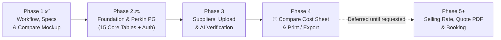

# Perkin FreightRate - Implementation Roadmap & Milestone Plan
**Version:** 2.0  
**Status:** DRAFT (Phase 1 In Progress - Awaiting User Approval to start Phase 2)  
**System:** Perkin FreightRate - Internal Freight Quotation Automation Platform

---

## 1. Roadmap Overview & Phasing Strategy (Scoped to Confirmed Priority)

Per feedback from Perkin Logistics' pricing team, **Phase 2–4 focus exclusively on Supplier Rate Intake, AI Verification, and the "① Compare Cost" Side-by-Side Sheet**. Selling Rate markup, Customer Quotation PDF, Acceptance, and Booking are **intentionally deferred to Phase 5+** until the pricing team requests them (avoiding unused tables and premature UI).

---

## 2. Detailed Phase Breakdown

### Phase 1: Planning, Workflow & Compare Cost Mockup — ✅ COMPLETE
- Completed all 11 architecture & workflow documents in `docs/`.
- Validated exact **① Compare Cost** layout (`COST Delta` | `COST msl` | `COST air`, `WHT | VAT | AMOUNT (THB) | AMOUNT (USD)`).

---

### Phase 2: Technical Foundation, Perkin PostgreSQL & Auth/RBAC — 🔜 NEXT
- **Goal:** Initialize Next.js App Router + Drizzle ORM + Pure PostgreSQL (ready for pgAdmin Server "Perkin"), Auth/RBAC, Audit Logs, and App Shell with **only the 15 core tables needed for Rate Comparison** (zero unused Selling/Quotation tables).
- **Key Tasks:**
  - Next.js (App Router) + TypeScript (Strict) + Tailwind CSS + shadcn/ui + Vitest + `decimal.js`.
  - Pure PostgreSQL (`pg` + Drizzle ORM + SQL migrations) + optional `docker-compose.yml` for offline dev.
  - 15 Core Tables: `users`, `sessions`, `audit_logs`, `processing_jobs`, `suppliers`, `charge_catalog`, `charge_aliases`, `exchange_rates`, `shipments`, `shipment_containers`, `source_documents`, `rate_records`, `rate_charges`, `cost_comparisons`, `cost_comparison_items`.
  - Seed Data: 29 confirmed Compare Cost subjects (with WHT/VAT defaults), FX snapshot, and 4 role test accounts (`admin`, `sales_co`, `sales_manager`, `management`).
  - HTTP-only Session Cookie Auth (`scrypt`) + RBAC Middleware + Append-only `audit_logs`.
  - App Shell: Login, Sidebar, Shipments List, Create Shipment (supporting multi-container like `1×40 DV + 1×20 GP`), and Shipment Workspace tabs (`Rate Input`, `Verify`, `Compare Cost`, `Timeline`).
- **Exit Gate:** Migrations + Seed run cleanly into PostgreSQL/pgAdmin, login & RBAC work, new multi-container Shipment can be created and logged in `audit_logs`.

---

### Phase 3: Supplier Directory, Rate Input & AI Verification (M1 + M2)
- **Goal:** Ingest supplier/agent rates via Image (`Ctrl+V` / upload), PDF, or pasted LINE/WhatsApp text, extract structured items with AI, and verify on a split-screen UI.
- **Key Tasks:**
  - M1: Supplier CRUD (`/suppliers`), private local file storage with signed URL API, SHA-256 duplicate file check.
  - M2: `unpdf` text extraction + Vercel AI SDK Vision fallback, Zod schema validation, prompt injection isolation, `processing_jobs` retry tracking.
  - M2: Split-screen verification canvas (zoom/page viewer on left; editable WHT/VAT/THB/USD charge rows + `charge_aliases` mapping on right).
- **Exit Gate:** Upload rate image/PDF/text $\rightarrow$ AI extracts draft $\rightarrow$ staff verifies into `Verified` status with source traceability.

---

### Phase 4: "① Compare Cost" Side-by-Side Sheet & Export (M3)
- **Goal:** Deliver the production **① Compare Cost** sheet matching the approved mockup 1-to-1, powered by live verified rates from PostgreSQL.
- **Key Tasks:**
  - Sticky left `Item / Subject` column + 2 to 5 side-by-side supplier blocks (`WHT | VAT | AMOUNT (THB) | AMOUNT (USD)` + double-bordered `TOTAL` row).
  - Direct inline editing, `+ Add Subject Row`, `Copy → All` for shared destination/insurance rows, `Highlight Blank / Missing`, and explicit `-` (N/A) vs Blank distinction.
  - Non-intrusive scope warning badges when a supplier omits major items.
  - Landscape Print Sheet & Excel/CSV Export matching the exact Compare Cost layout.
  - Save comparison snapshot & record chosen supplier with notes in `audit_logs`.
- **Exit Gate:** Compare 2–5 verified suppliers (`Delta`, `MSL`, `Air`) on real DB data, print/export sheet cleanly, and save comparison history.

---

### Phase 5+ (Deferred — On Hold Until Requested by Pricing Team)
- **Selling Rate & Markup Calculator (M4):** Only built when the team wants in-app selling price markup/margin calculations.
- **Customer Quotation PDF & Versioning (M5) + Customer Acceptance (M6):** Bilingual PDF generation with isolated customer tables.
- **Internal Booking Handover (M7) & Executive Financial Dashboard (M8):** One-click booking conversion and profit analytics.
- **Hardening, E2E Playwright Tests & On-Premise / Production Deployment.**
