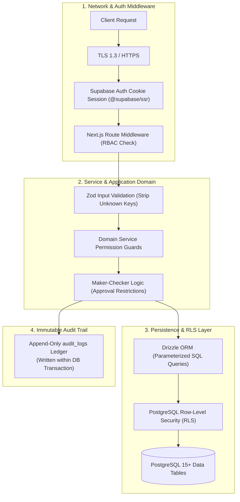

# Perkin FreightRate - Security & Confidentiality Architecture
**Version:** 2.0  
**Status:** DRAFT (Awaiting Company Data for TBD Items)  
**System:** Perkin FreightRate - Internal Logistics Workflow Platform

---

## 1. Security Architecture & Threat Model

Perkin FreightRate handles sensitive commercial intelligence, including proprietary carrier buying costs, confidential margin structures, customer lists, and financial transactions. 

The security architecture implements **Defense-in-Depth** across four layers:
1. **Perimeter & Ingress Security:** HTTPS enforcement, CORS restrictions, rate limiting, and SameSite HTTP-only session cookies.
2. **Application Authorization (RBAC):** Middleware checks, explicit service-layer permission validation, and maker-checker segregation of duties.
3. **Database Security (PostgreSQL RLS):** Row-Level Security policies operating directly at the database engine level.
4. **Data Confidentiality by Design:** Physical and logical segregation of internal financial data from customer-facing quotation tables.

---

## 2. Role-Based Access Control (RBAC) Matrix

The system defines four initial roles with distinct operational authorities:

| Permission Token | Sales Co. | Sales Manager | Management | System Admin |
|---|:---:|:---:|:---:|:---:|
| `shipments:create_edit` | ✅ (Assigned) | ✅ (All) | ❌ (Read Only) | ✅ (All) |
| `rates:ingest_verify` | ✅ | ✅ | ❌ | ✅ |
| `cost:view_buying_rates` | ✅ (Assigned) | ✅ (All) | ✅ (All) | ✅ (All) |
| `pricing:calculate_standard` | ✅ | ✅ | ❌ | ✅ |
| `pricing:view_margins_gp` | ✅ (Assigned) | ✅ (All) | ✅ (All) | ✅ (All) |
| `pricing:approve_subthreshold`| ❌ | ✅ (Except Own) | ✅ | ✅ |
| `quotations:generate_preview`| ✅ | ✅ | ❌ | ✅ |
| `quotations:send_customer` | ✅ | ✅ | ❌ | ✅ |
| `acceptance:record` | ✅ | ✅ | ❌ | ✅ |
| `bookings:create_convert` | ✅ | ✅ | ❌ | ✅ |
| `analytics:view_executive_kpis`| ❌ | ✅ | ✅ | ✅ |
| `settings:manage_reference_data`| ❌ | ❌ | ❌ | ✅ |
| `audit:inspect_logs` | ❌ | ❌ | ✅ | ✅ |

### Maker-Checker Enforcement Rule
If an action requires managerial sign-off (e.g., selling rate with gross margin $< 10\%$ or commercial discount $> 0\%$), the application strictly enforces:
$$\text{actor\_id} \ne \text{created\_by\_id}$$
A Sales Manager who creates their own rate quotation cannot sign off on their own exception without an escalation to Management or Admin, with mandatory written audit remarks.

---

## 3. Data Confidentiality & Anti-Leakage Controls

### 3.1 The Confidentiality Guarantee
Customer quotations, emails, and PDFs must **NEVER** expose:
- Supplier/Agent corporate names, contact persons, or addresses.
- Internal buying costs, itemized carrier surcharges, or currency exchange spreads.
- Internal markups, gross profit amounts, or profit margin percentages.
- Internal sales coordinator notes, operational instructions, or negotiation remarks.

### 3.2 Technical Implementation:
1. **Physical Table Isolation:** Customer line items live in `quotation_items`, while supplier costs live in `rate_charges` and internal pricing calculations live in `selling_rates`. There is **no foreign key from `quotation_items` to `rate_charges`**.
2. **Payload Sanitization:** The quotation PDF renderer consumes an immutable, customer-facing snapshot `QuotationCustomerPayload` that is completely decoupled from internal data models.
3. **Automated CI Leakage Assertion:** An automated test inspects the PDF generation data model and fails the build if any of the following terms appear in the payload schema:
   `['cost', 'supplier', 'carrier', 'markup', 'margin', 'gross_profit', 'buying', 'gp']`.

---

## 4. File Storage & Upload Security

1. **Private Storage Buckets:** All uploaded rate documents (PDFs, images) and customer acceptance files (signed quotations, POs) are stored in private Supabase Storage buckets. Direct public URLs are disabled.
2. **Short-Lived Signed URLs:** The browser accesses documents via cryptographic signed URLs with a maximum lifespan of $15\text{ minutes}$ ($900\text{ seconds}$).
3. **MIME & Magic Bytes Inspection:** Uploaded files are inspected server-side by verifying file magic bytes (`%PDF-`, PNG header, JPEG header). Files with disguised extensions or executable payloads (`.exe`, `.sh`, `.js`, `.html`, `.svg`) are rejected immediately.
4. **Malicious Content Defense:** All uploaded files are stored outside the web root. Files are served with HTTP response headers:
   - `Content-Security-Policy: default-src 'none'`
   - `X-Content-Type-Options: nosniff`
   - `Content-Disposition: attachment` (for unverified downloads)

---

## 5. Input Validation, Injection Defense & XSS

1. **Zod Schema Gateways:** Every API endpoint and Server Action parses incoming JSON payloads through strict Zod schemas with `.strip()` or `.strict()`, preventing prototype pollution and mass-assignment attacks.
2. **SQL Injection Prevention:** All database operations utilize Drizzle ORM's parameterized query engine. Raw concatenated SQL strings are strictly prohibited.
3. **Cross-Site Scripting (XSS):** React automatically escapes text rendering. For PDF output, `@react-pdf/renderer` renders to canvas/PDF primitives, avoiding DOM injection.
4. **Cross-Site Request Forgery (CSRF):** Next.js Server Actions utilize intrinsic CSRF token verification. Session cookies are configured with `SameSite=Lax`, `Secure=true`, and `HttpOnly=true`.

---

## 6. Prompt Injection Defense (AI Layer)

Documents ingested into the AI extraction pipeline are classified as **untrusted data payloads**:
1. Ingested text is enclosed within `<untrusted_document_payload>` boundary tags.
2. System prompts instruct the LLM that text inside the payload must be treated solely as passive data.
3. The LLM extraction call is configured with zero tools and zero network access.
4. Output must conform to `ExtractionResultSchema` via `generateObject()`. If the model attempts to converse or execute instructions, the parser fails safely and logs the incident.

---

## 7. Append-Only Audit Logging

All system mutations write a synchronous record to the `audit_logs` table within the same database transaction:
- **Captured Fields:** `entity_type`, `entity_id`, `action`, `actor_id`, `previous_state` (JSONB), `new_state` (JSONB), `reason`, `ip_address`, `created_at`.
- **Immutability:** PostgreSQL RLS policies forbid `UPDATE` and `DELETE` queries on `audit_logs` for all database roles, ensuring a tamper-evident operational record.
