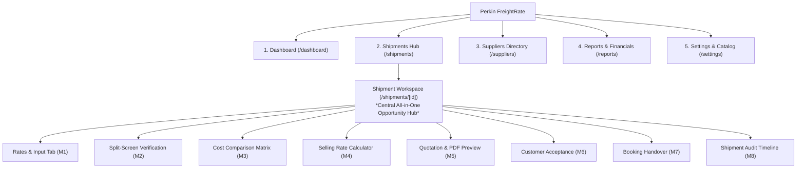

# Perkin FreightRate - UI/UX Design System & Screen Specifications
**Version:** 2.0  
**Status:** DRAFT (Awaiting Company Data for TBD Items)  
**Design Standards:** Better Interface Design Engineering Principles + WCAG 2.2 AA Compliance  
**UI Stack:** Tailwind CSS + shadcn/ui (Radix UI) + TanStack Table + Lucide React

---

## 1. Design Engineering Principles & Standards

The application user interface is optimized for high-density, professional desktop productivity, enabling freight-forwarding coordinators to rapidly verify documents, compare commercial terms, and calculate prices with zero calculation fatigue.

### Core Design Rules (Non-Negotiables)
1. **Desktop-First Ergonomics:** Designed for high-resolution displays ($1920\times1080$ and $1440\times900$) with full keyboard accessibility. Responsive down to 320px mobile viewport without clipping essential controls.
2. **Numeric Rigor & Tabular Numbers:** All financial figures, container counts, currency codes, and exchange rates utilize `font-variant-numeric: tabular-nums` to guarantee vertical column alignment.
3. **Concentric Border Radii:** Outer container border-radius is calculated strictly as `outer_radius = inner_radius + padding` to prevent visual awkwardness.
4. **Spacing Hierarchy:** Inter-group spacing is at least double intra-group spacing (`gap_between >= 2 * gap_inside`).
5. **Accessible Controls & Focus Rings:** Every interactive button, input, and icon includes explicit `aria-label` or visible `<label>`. Focus states utilize visible, high-contrast `:focus-visible` rings (`ring-2 ring-primary ring-offset-2`).
6. **Targeted Transitions:** Generic `transition: all` is prohibited. Transitions explicitly state target properties with durations $\le 150\text{ms}$ and respect `@media (prefers-reduced-motion: reduce)`.
7. **Semantic Color Tokens:** Never use raw hex values. All colors map to functional semantic tokens:
   - Primary: `--color-primary` (Perkin Corporate Deep Navy `#0F294A`)
   - Accent / Action: `--color-accent` (Precision Blue `#2563EB`)
   - Success / Verified: `--color-success` (Forest Emerald `#059669`)
   - Warning / Unmapped: `--color-warning` (Warm Amber `#D97706`)
   - Destructive / Expired: `--color-destructive` (Crimson `#DC2626`)
   - Surface Neutral: `--color-surface-bg` (`#F8FAFC`), Surface Elevated: `--color-surface-card` (`#FFFFFF`)

---

## 2. Information Architecture & Navigation

### Global Sidebar Navigation:
- **Dashboard:** Pipeline KPIs, priority queues (pending verifications, awaiting approvals).
- **Shipments:** Master table of all active, quoted, and booked shipments.
- **Suppliers / Agents:** Directory of freight forwarders, shipping lines, and agent contacts.
- **Reports:** Conversion rates, route analytics, gross profit analysis (role-restricted).
- **Settings:** Dynamic Reference Data (`charge_catalog`, `charge_aliases`, `charge_units`, `exchange_rates`, `pricing_rules`).
- **Users:** Staff management and role assignments (Admin only).

---

## 3. The Shipment Workspace: Central All-in-One Hub

To eliminate disjointed context switching, **all work for a specific customer inquiry lives in the unified Shipment Workspace (`/shipments/[id]`)**.

### Workspace Layout:
1. **Header Bar:**
   - Left: Shipment Reference (`SHP-202611-0001`), Customer Name, Route Badge (`THLCH → CNSHA`), Container Badge (`2 x 40'HQ`).
   - Right: Current Computed Shipment Status Badge (e.g., `Quotation Sent - Waiting for Customer`), Assigned Sales Co., Quick Action Menu.
2. **Horizontal Workflow Stepper:**
   Interactive progress indicator highlighting current phase:
   $$\text{Ingestion} \rightarrow \text{Verification} \rightarrow \text{Comparison} \rightarrow \text{Pricing} \rightarrow \text{Quotation} \rightarrow \text{Acceptance} \rightarrow \text{Booking}$$
3. **Tabbed Functional Panels:**
   Allows the user to inspect any stage of the opportunity without leaving the page.

---

## 4. Key Screen Detailed UX Specifications

### 4.1 M1: Rate Document Ingestion
- **Tri-Modal Ingestion Box:**
  - Drag-and-drop file target accepting multi-file PDFs and images.
  - Clipboard listener enabling instant image pasting (`Ctrl + V`).
  - Text area for pasting raw LINE or WhatsApp chats.
- **Live Upload Cards:** Display file name, detected MIME type, SHA-256 duplicate warning (if found), and animated progress bar during AI processing.

### 4.2 M2: Split-Screen Verification Interface
- **Left Pane (50% Viewport Width) - Document Canvas:**
  - High-performance PDF/image canvas with pan and smooth zoom ($50\% - 300\%$).
  - Page navigation controls (`< Page 1 of 4 >`).
  - Download original file button.
  - Bounding box highlight that visually links to the currently focused charge input in the right pane.
- **Right Pane (50% Viewport Width) - Structured Verification Form:**
  - **Supplier & Route Header:** Autocomplete supplier select, loading port, discharge port, container type, validity dates.
  - **Itemized Charges Table:**
    - Columns: Charge Name, Category, Catalog Subject (Dropdown), Amount, Currency, Unit, Included checkbox, Excluded checkbox, Actions.
    - Amber Warning Badges on **Unmapped Charges** with single-click mapping: *"Map to THC Origin and remember alias"*.
  - **Bottom Action Bar:**
    - "Reject Rate Record" (requires reason).
    - "Save as Draft".
    - "Confirm & Verify Rate" (validates mandatory fields; advances state to `Verified`).

### 4.3 M3: Side-by-Side Cost Comparison Sheet ("Compare Cost" Layout)
Designed to match Perkin Logistics' exact accounting comparison sheet layout — clean, flat, spreadsheet-familiar, and printable:

- **Layout Structure (1-to-1 with Company Compare Cost Sheet):**
  - **Left Sticky Column (`Item / Subject`):** One unified vertical list of all cost subjects across the compared suppliers (standard subjects + any supplier-specific extra rows). Rows stay flat and aligned across all columns (no collapsible accordions hiding rows). Section labels like `Local Charge` appear cleanly inline as sub-header rows.
  - **Side-by-Side Supplier Blocks (2 to 5 Blocks horizontally, separated by a crisp gap):**
    - Top Banner per Block: **`COST <Supplier Name>`** (e.g., `COST Delta`, `COST msl`, `COST air`) with validity status indicator and selection toggle.
    - Fixed 4 Sub-Columns inside **every** Supplier Block:
      | `WHT` | `VAT` | `AMOUNT (THB)` | `AMOUNT (USD)` |
    - All numeric cells are right-aligned with `font-variant-numeric: tabular-nums` and 2 decimal places (`75,800.00`, `2,295.00`, `55.00`).
    - Cells with no charge show blank (not quoted) or `-` (confirmed N/A), subtly tinted only if a mandatory item is missing so the sheet remains visually clean.
  - **Bottom Total Row (per Supplier Block):**
    - Double-bordered accounting total row summing `Total WHT` | `Total VAT` | `Total AMOUNT (THB)` | `Total AMOUNT (USD)` directly beneath each supplier block.
- **Direct Spreadsheet Productivity Controls:**
  - **Add / Map Subject Row:** Add a new item row to the left column at any time; it automatically extends across all supplier blocks.
  - **Copy Row Across Suppliers:** Quick action icon on common rows (e.g., `Insurance`, `Dest TRML HANDLG`, `DEST DOC FEE`, `EQPT CLEANING`, `CIS / CIC`) to copy the same value across all supplier blocks in one click.
  - **Non-Intrusive Comparability Warnings:** Subtle warning tooltip/badge on a supplier's total if key lines (e.g., Sea Freight or Origin Pickup) are blank compared to other suppliers, without altering or hiding the raw accounting total.
  - **Select Supplier Action:** Explicit **"Select this Supplier"** button below each supplier's Total block to advance to M4 Selling Rate Calculator (no auto-selection).
  - **Print / Export Sheet:** Export or print the Compare Cost table in this exact side-by-side landscape layout for internal review.

### 4.4 M4: Selling Rate Calculator
- **Cost Baseline Card:** Summarizes selected supplier buying costs converted to billing currency (THB).
- **Pricing Input Form:**
  - Additional internal costs (e.g., Trucking: THB 3,500, Clearance: THB 1,500).
  - Markup controls: Toggle between Percentage Markup (e.g., $15\%$) or Fixed Markup per Container (e.g., THB 4,000/cntr).
  - Commercial discount field.
  - VAT toggle and percentage input (default $7\%$).
- **Live Financial Summary KPI Grid:**
  - **Total Selling Price:** Big bold numeric display (`font-variant-numeric: tabular-nums`).
  - **Gross Profit:** Net THB profit.
  - **Markup % vs Gross Margin %:** Distinctly displayed side-by-side with tooltips explaining the formula.
  - **Manager Approval Alert:** If Gross Margin $< 10\%$, a prominent warning banner explains: *"Requires Sales Manager approval before quotation can be dispatched"*.

### 4.5 M5: Customer Quotation Preview & PDF
- **Quotation Form:** Customer contact details, valid until date, transit time description, free time terms, remarks.
- **Customer Line Items Table:** Sanitized list of selling charges. Supplier identity and profit numbers are physically absent from this screen.
- **Bilingual Live PDF Previewer:**
  - Renders `@react-pdf/renderer` output in real time.
  - Toggle between Thai and English view.
  - Official company header, registration numbers, bank details, and formal terms.
- **Action Controls:**
  - "Download PDF"
  - "Print Quotation"
  - "Create Revision (v2)"
  - "Record Quotation Sent" (modal capturing recipient, channel, and date).

### 4.6 M6 & M7: Acceptance & Booking Handover
- **Acceptance Modal:** Captures customer agreement, PO number, confirmation date, and proof upload (signed PDF / screenshot).
- **Booking Handover Screen:**
  - Pre-populates all shipment, port, commodity, and container fields.
  - Operational input fields: Carrier Booking Ref, Vessel / Voyage, ETD, ETA, Cargo Closing Deadline, Operational Notes.
  - "Generate Booking Record": Creates immutable booking `PK-BK-202611-0001` with zero re-typing.
