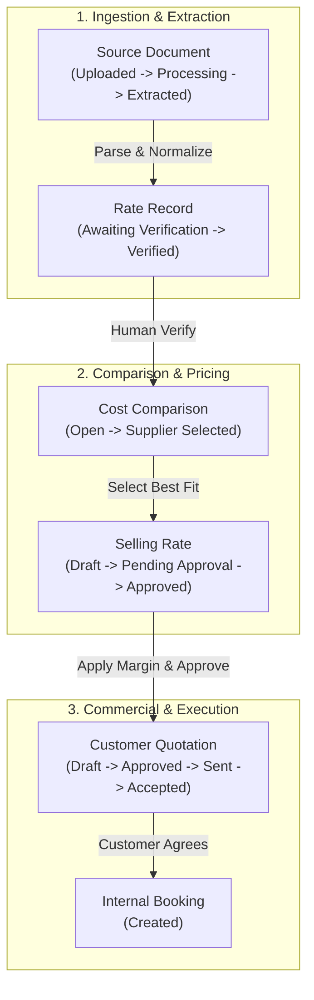
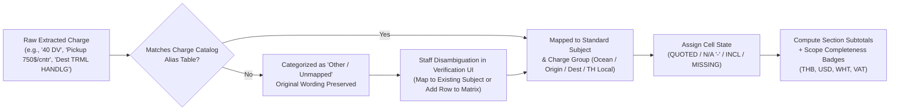
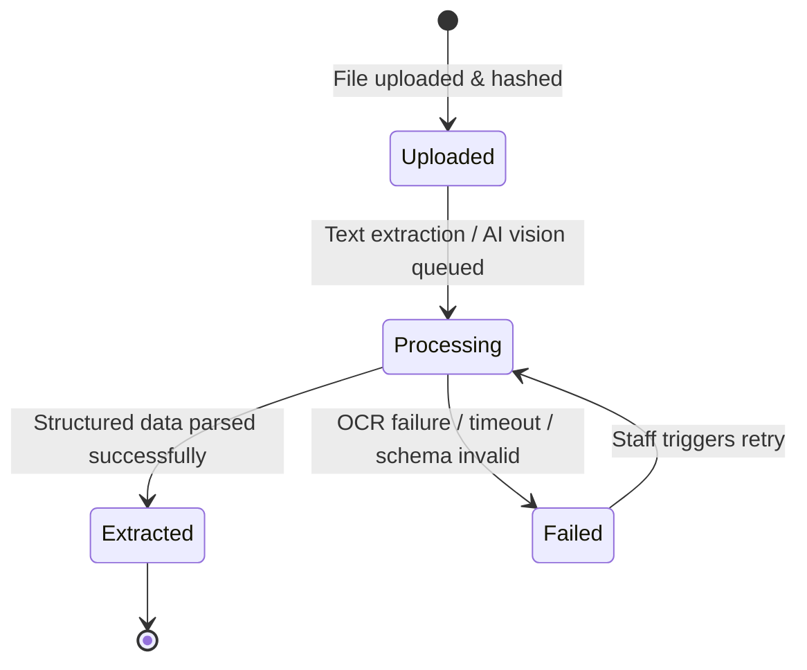
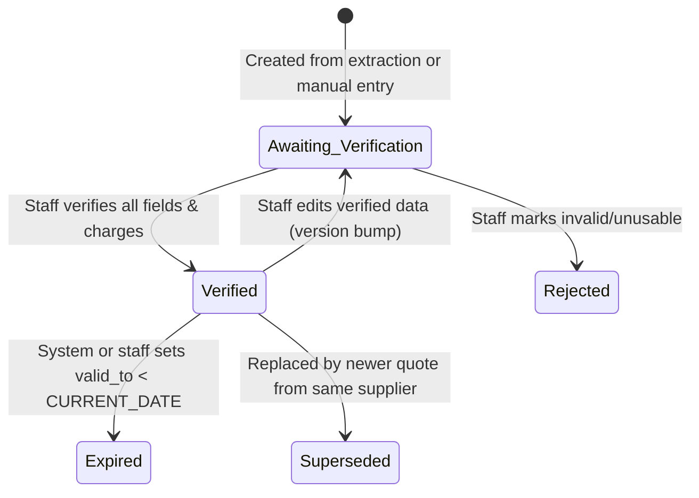
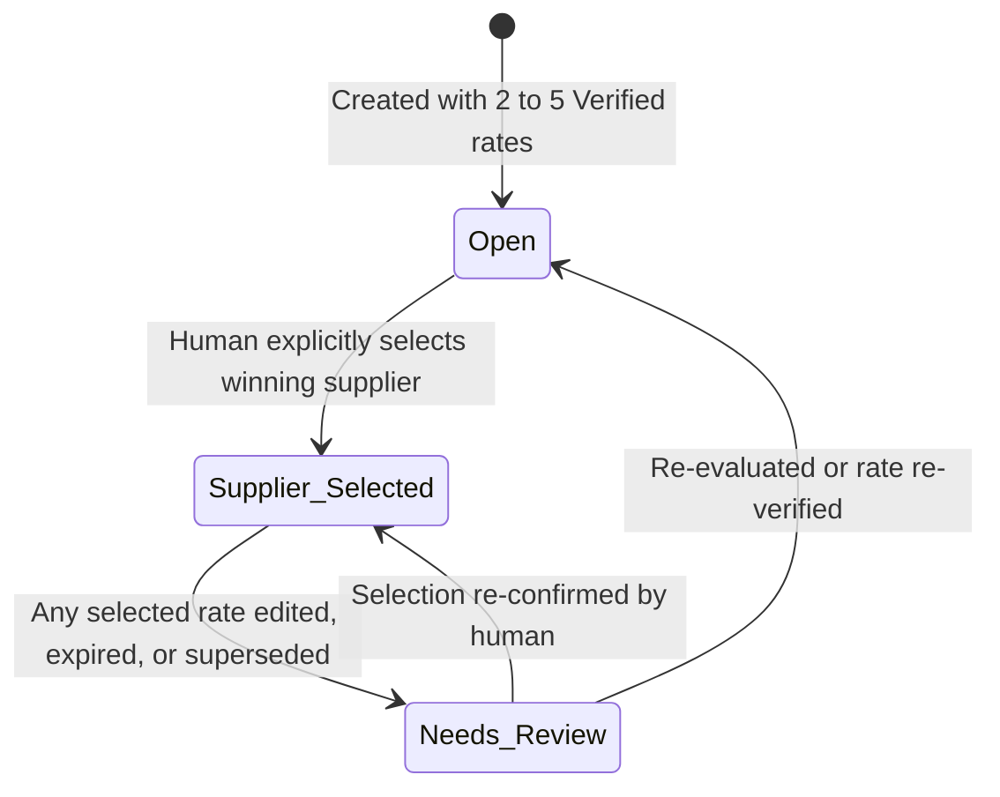
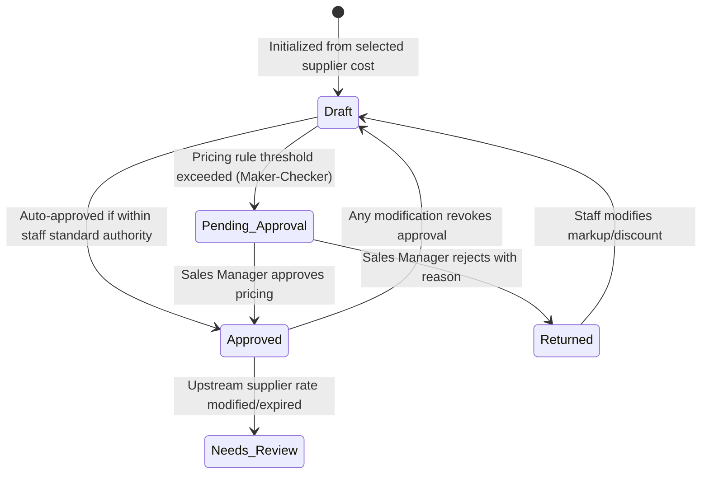
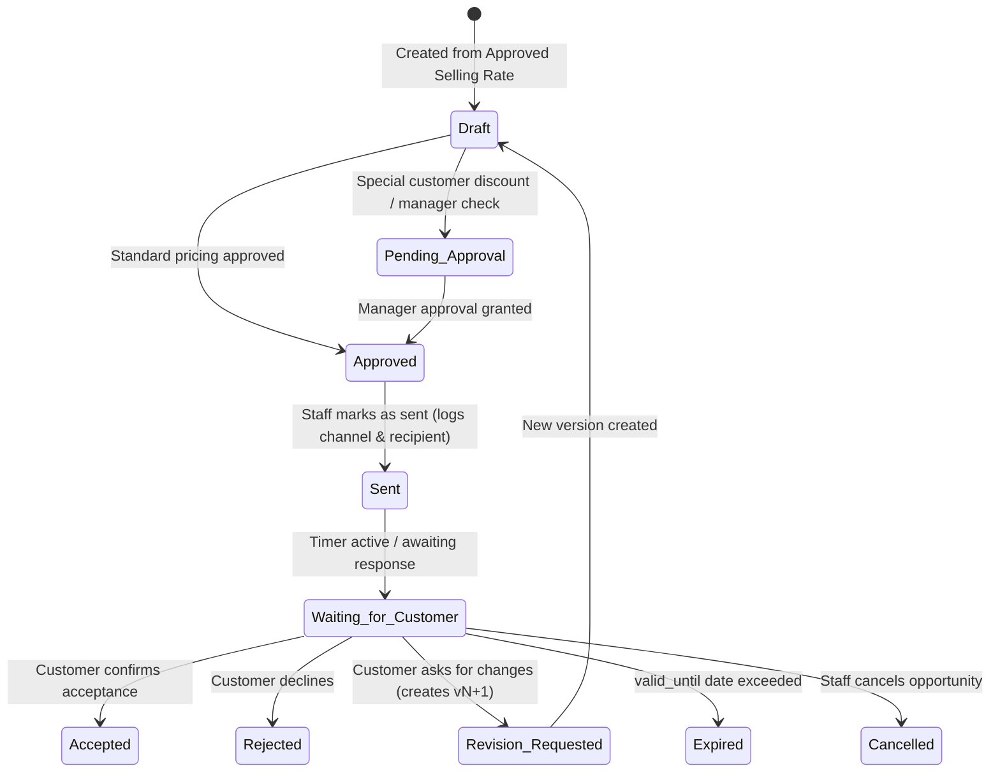
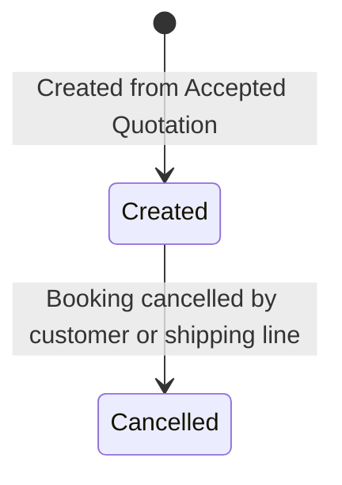
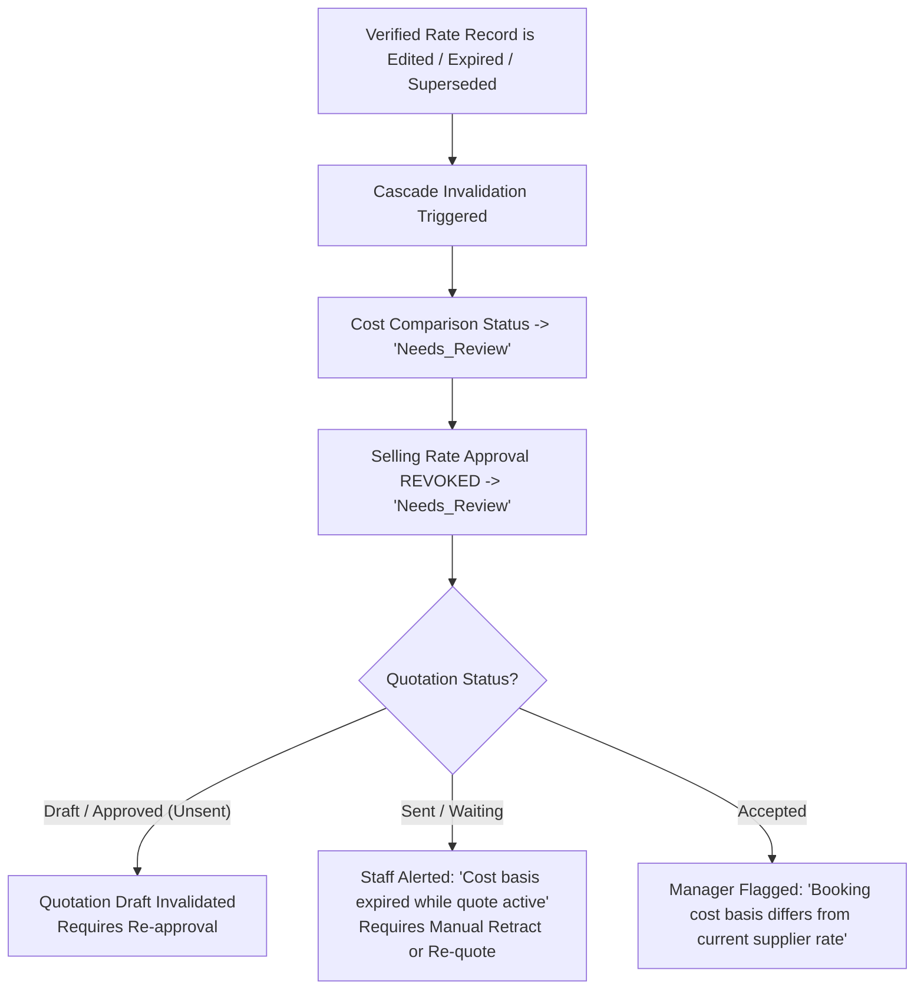

# Perkin FreightRate - Workflow Architecture & State Machines
**Document Version:** 2.0  
**Status:** DRAFT (Awaiting Company Data for TBD Items)  
**System:** Perkin FreightRate (Perkin Logistics (Thailand) Co., Ltd.)

---

## 1. Executive Summary & Design Philosophy

Perkin FreightRate is an internal workflow automation platform designed to streamline freight-forwarding rate acquisition, comparison, pricing calculation, quotation generation, acceptance recording, and booking handover.

### Core Workflow Pipeline
$$\text{Supplier/Agent Rate} \longrightarrow \text{Extraction \& Verification} \longrightarrow \text{Cost Comparison} \longrightarrow \text{Selling Rate} \longrightarrow \text{Customer Quotation} \longrightarrow \text{Customer Acceptance} \longrightarrow \text{Internal Booking}$$

### Key Architectural Tenet: Per-Entity State Machines
Rather than maintaining a single monolithic status column for a shipment (which creates conflicting states and invalid transitions), **each domain entity owns its own independent, deterministic finite-state machine (FSM)**. The overall **Shipment Status is a pure computed projection** derived dynamically from the states of its child entities.



---

## 2. Dynamic Comparison Sheet ("① Compare Cost") & Subject Resolution Workflow

Confirmed directly from Perkin Logistics' physical **"① compare cost"** sheet:
- **Left Sticky Column (`Item`):** One flat, unified vertical list of cost subjects shared across all compared suppliers (e.g., `SEA FREIGHT CHARGE`, `40 DV`, `20 GP`, `Local Charge`, `HANDING FEE`, `Pickup`, `Dest TRML HANDLG`, `CIS / CIC`, etc., plus any new rows added from a supplier quote).
- **Side-by-Side Supplier Blocks (`COST Delta` | `COST msl` | `COST air` ... up to 5 blocks):**
  - Each supplier sits in its own clean bordered vertical block side by side, separated by a crisp whitespace gap.
  - Every supplier block always displays the exact 4 accounting columns: **`WHT` | `VAT` | `AMOUNT (THB)` | `AMOUNT (USD)`**.
  - At the bottom of each block is a boxed **`TOTAL`** row summing `WHT`, `VAT`, `AMOUNT (THB)`, and `AMOUNT (USD)` independently for that supplier.

```
+-----------------------------------+  +-----------------------------------------+  +-----------------------------------------+
| Item / Subject                    |  |               COST Delta                |  |                COST msl                 |
|                                   |  |  WHT  |  VAT  | AMOUNT(THB) | AMOUNT(USD)|  |  WHT  |  VAT  | AMOUNT(THB) | AMOUNT(USD)|
+-----------------------------------+  +-------+-------+-------------+-----------+  +-------+-------+-------------+-----------+
| SEA FREIGHT CHARGE                |  |       |       |             |           |  |       |       |             |           |
| 40 DV                             |  |       |       |   75,800.00 |  2,295.00 |  |       |       |           - |           |
| 20 GP                             |  |       |       |   60,600.00 |  1,835.00 |  |       |       |           - |           |
| Local Charge                      |  |       |       |             |           |  |       |       |             |           |
| HANDING FEE (THB 200 / HBL)       |  |       |       |      200.00 |           |  |       |       |      200.00 |           |
| 1x40 TRANSPORTATION CHARGE        |  | 55.00 |       |    5,500.00 |           |  | 55.00 |       |    5,500.00 |           |
| Pickup (750$ / container)         |  |       |       |             |           |  |       |       |   49,500.00 |  1,500.00 |
| ...                               |  |  ...  |  ...  |         ... |       ... |  |  ...  |  ...  |         ... |       ... |
| Dest TRML HANDLG                  |  |       |       |    7,400.00 |           |  |       |       |    7,400.00 |           |
+-----------------------------------+  +-------+-------+-------------+-----------+  +-------+-------+-------------+-----------+
| TOTAL                             |  | 55.00 |     - |  166,443.43 |  4,340.00 |  | 55.00 |     - |  119,943.43 |  2,925.00 |
+-----------------------------------+  +-------+-------+-------------+-----------+  +-------+-------+-------------+-----------+
```

### 2.1 Four Explicit Cell States (Preventing False Comparisons)
In real freight quotes, an empty cell is **NOT** equal to zero. Every cell `(Subject, Supplier)` in the comparison matrix has one of four explicit states:

| Cell State | Display | Meaning | Effect on Comparison Total |
|---|---|---|---|
| `QUOTED` | `49,500.00` / `1,500.00` | Supplier quoted a price (with optional WHT & VAT) | Included in block bottom `TOTAL` |
| `NOT_APPLICABLE` | `-` | Supplier explicitly confirmed N/A or zero charge (e.g., Air's `BL`, `Handling`, `Overweight`) | Treated as `0.00` (No warning) |
| `INCLUDED` | `INCL` | Explicitly bundled inside another charge (e.g., inside Sea Freight) | Treated as `0.00` (Linked note shown) |
| `MISSING` | `Blank` (subtle warning indicator) | Supplier **omitted / did not quote** this item (e.g., MSL omitted `40 DV`/`20 GP`; Delta omitted `Pickup`) | **Shows non-intrusive Missing Warning badge on Total without altering raw sum** |

### 2.2 Three-Tier Dynamic Charge Resolution Pipeline



### 2.3 Shared Baseline Charges (Avoiding Repetitive Entry)
Real comparison sheets frequently contain **fixed destination or shared shipment costs** identical across all suppliers (for example: `Insurance`, `Dest TRML HANDLG`, `DEST DOC FEE`, `EQPT CLEANING`, `Equipment Maintenance Premium`, `CIS / CIC`).
- Staff can define **Shipment Baseline Charges** once per shipment and apply them across all compared suppliers with one click.
- If a specific supplier quotes a different amount for a baseline item, staff can override that supplier's individual cell without altering the others.

### 2.4 Multi-Container Shipments
A single shipment inquiry may contain **multiple container types** simultaneously (e.g., `1x40 DV` + `1x20 GP` in the same shipment).
- Both Ocean Freight rows (`40 DV`, `20 GP`) and transport rows (`1x40 TRANSPORTATION CHARGE`, `1x20 TRANSPORTATION CHARGE`) are supported within one comparison matrix.
- Per-container charges (e.g., `Pickup $750/container` $\times 2 = \$1,500$) automatically reference the shipment's total container count (`shipment_containers`).

---

## 3. Detailed Entity State Machines

### 3.1 Entity 1: Source Document (`source_documents`)



- **States:**
  - `Uploaded`: File stored in private bucket; SHA-256 duplicate check completed.
  - `Processing`: Background job running text-layer extraction (`unpdf`) or Vision LLM parsing.
  - `Extracted`: Structured JSON produced and validated against Zod schema; child draft `rate_records` created.
  - `Failed`: Extraction failed (corrupted file, unreadable image, model timeout). Error logged.
- **Guards:**
  - Duplicate file warning generated if SHA-256 already exists for the same shipment.
  - Maximum retry attempts: 3.

---

### 3.2 Entity 2: Rate Record (`rate_records`)



- **States:**
  - `Awaiting_Verification`: Draft extracted data. Not permitted in comparisons or pricing calculations.
  - `Verified`: Human staff reviewed, corrected charge units/currencies, and approved the record.
  - `Rejected`: Rate unusable or irrelevant.
  - `Expired`: Rate validity date has passed.
  - `Superseded`: A newer rate received from the same supplier for the same route replaces this one.
- **Transition Guards:**
  - Transition to `Verified` requires:
    1. Mandatory fields non-null: `supplier_id`, `pol_port_id`, `pod_port_id`, `container_type_id`, `valid_to`.
    2. Zero unmapped charges remaining, or explicit acknowledgment of unmapped charges.
    3. Currency specified on all rate charge lines.
  - Editing a `Verified` rate revokes verification and triggers cascade invalidation down the chain.

---

### 3.3 Entity 3: Cost Comparison (`cost_comparisons`)



- **States:**
  - `Open`: Rates are being compared side-by-side. No supplier selected yet.
  - `Supplier_Selected`: Staff explicitly selected one supplier rate as the commercial basis.
  - `Needs_Review`: An upstream event occurred (e.g., selected rate expired or was re-edited).
- **Transition Guards:**
  - Minimum 2, maximum 5 rates per comparison.
  - All included rates MUST be in `Verified` state.
  - Core parameters MUST match across all compared rates: Origin Port (POL), Destination Port (POD), Container Type, and Commodity Class.
  - Supplier selection is an **explicit human action**; the system NEVER auto-selects the lowest cost.
  - If currencies differ, conversion must use official rates from `exchange_rates` with visible disclaimer; if conversion is unconfigured, total comparison is disabled.

---

### 3.4 Entity 4: Selling Rate (`selling_rates`)



- **States:**
  - `Draft`: Selling rate being calculated (markup, internal charges, currency conversion).
  - `Pending_Approval`: Requires Sales Manager review due to policy triggers.
  - `Approved`: Locked and ready to be used in customer quotations. A snapshot of cost, exchange rates, and formula inputs is frozen.
  - `Returned`: Manager rejected pricing; sent back for rework.
  - `Needs_Review`: Upstream cost invalidated after approval.
- **Pricing Entry & Approval Policy Triggers (Configurable in `pricing_rules`):**
  - **No Auto-Markup (Confirmed):** The system starts with `0` / empty markup; **Sales staff manually add their own markup or custom selling price** per shipment/line.
  - **Margin Approval Thresholds (Currently Disabled / Optional):** `require_margin_approval = false` (`min_gross_margin_percent = null`, `min_markup_percent = null`, `max_discount_percent = null`) until Perkin Logistics confirms formal approval thresholds. When enabled in Settings later, violations route automatically to `Pending_Approval`.
  - Selling price below cost: displays a prominent warning/block guard unless explicitly overridden.
- **Maker-Checker Guard:**
  - The user who created the selling rate cannot approve it if approval is required.

---

### 3.5 Entity 5: Customer Quotation (`quotations` & `quotation_versions`)



- **Immutability & Versioning:**
  - A quotation in `Sent` status is **strictly immutable**.
  - Any customer counter-offer or revision request creates `Version N+1`.
  - The previous version is marked `Superseded`.
- **Strict Data Confidentiality Guard:**
  - Customer quotation line items and PDF generation payloads are read **only from `quotation_items`**.
  - `quotation_items` NEVER contain supplier IDs, supplier costs, markups, or internal profit calculations.
  - Any joined query containing internal cost columns during customer PDF rendering triggers an immediate architectural failure.

---

### 3.6 Entity 6: Internal Booking (`bookings`)



- **Transition Guards:**
  - Associated Quotation MUST be in `Accepted` status.
  - Quotation MUST NOT be `Expired`.
  - Exactly one booking per accepted quotation (`UNIQUE(quotation_id)` constraint in database).
  - Snapshots customer details, accepted rate version, shipping line, origin/destination, and verified cost basis.

---

## 4. Computed Shipment Status Projection

The overarching shipment status is derived deterministically from the child entities using the following decision matrix:

| Derived Shipment Status | Condition / Formula |
|---|---|
| `New / Draft` | Source documents uploaded; no verified rates yet. |
| `Rates Pending Verification` | One or more rate records are `Awaiting_Verification`. |
| `Ready for Comparison` | $\ge 2$ rate records are `Verified`; no active comparison or comparison is `Open`. |
| `Supplier Selected` | Cost comparison has a selected supplier; selling rate is `Draft`. |
| `Pricing Pending Approval` | Selling rate is `Pending_Approval`. |
| `Quotation Draft` | Selling rate is `Approved`; quotation is `Draft` or `Pending_Approval`. |
| `Quotation Approved` | Latest quotation version is `Approved` but not yet `Sent`. |
| `Quotation Sent` | Latest quotation version is `Sent` or `Waiting_for_Customer`. |
| `Quotation Accepted` | Latest quotation version is `Accepted`; no booking created yet. |
| `Quotation Rejected` | Latest quotation version is `Rejected`. |
| `Quotation Expired` | Latest quotation version is `Expired`. |
| `Booking Created` | A booking record exists for the accepted quotation. |
| `Needs Attention` | Upstream rate invalidated, expired, or comparison flagged `Needs_Review`. |

---

## 5. Upstream Cascade Invalidation Rules

To ensure commercial integrity, changes to upstream financial documents must safely cascade downstream:



### Cascade Execution Protocol:
1. **Unsent Drafts:** The system automatically revokes approvals on unsent selling rates and quotation drafts. Warning banners are displayed to the assigned sales representative.
2. **Sent Quotations:** The system **NEVER** silently alters or deletes a quotation that has already been delivered to a customer. Instead, an alert flag is raised on the shipment workspace indicating that the underlying cost basis has shifted.

---

## 6. Maker-Checker & Override Governance

| Action | Standard Role | Approval Required? | Approver Role | Maker-Checker Rule |
|---|---|---|---|---|
| **Verify Rate Record** | Sales Co. | No | - | Self-check allowed |
| **Select Supplier** | Sales Co. | No | - | Self-choice |
| **Standard Pricing** | Sales Co. | No (if within thresholds) | - | Auto-approved |
| **Sub-threshold Margin** | Sales Co. | **YES** | Sales Manager / Management | Creator cannot approve |
| **High Discount Pricing** | Sales Co. | **YES** | Sales Manager | Creator cannot approve |
| **Below Cost Pricing** | Blocked | **STRICT BLOCK** | Management only | Special business override |
| **Send Quotation** | Sales Co. | No (if approved) | - | Explicit human action |
| **Record Acceptance** | Sales Co. | No | - | Requires customer proof attachment |
| **Convert to Booking** | Sales Co. | No (if valid) | - | Single-click handover |
| **Override Expired Quote to Booking** | Sales Co. | **YES** | Sales Manager / Admin | Mandatory audit note required |

---

## 7. Dynamic Subject Resolution & Comparison Engine Logic

Based on the confirmed real-world comparison template, charges are organized into **5 Data-Driven Charge Groups** (all stored in `charge_catalog`, editable without code changes):

1. **Hierarchy of Charge Groups (Seeded from Real Data):**
   - **Group 1: Ocean / Sea Freight & Marine Surcharges**
     - `SEA FREIGHT CHARGE` (lump sum or split by container: `40 DV`, `20 GP`, `40 HQ`, etc.)
     - `CONTAINER IMBALANCE SURCHARGE` (CIS / CIC)
     - `LOW SULPHUR SURCHARGE` (LSS)
     - `Emergency BUNKER` (EBS / BAF)
   - **Group 2: Origin / Overseas Charges (Ex-Works / Drayage / Origin Local)**
     - `Pickup ($/container)`, `Live load (free hrs + overtime rate)`, `Chassis rental ($/day/container, min days)`, `Overweight surcharge ($/container)`, `Tri-axel chassis`, `Prepull surcharge`, `PIERPASS / CTF`, `Yard Storage ($/day)`, `BL`, `Handling`, `Document fee per HAWB`
   - **Group 3: Destination Port / Carrier Local Charges (Thailand Arrival)**
     - `Dest TRML HANDLG` (Destination THC), `DEST DOC FEE`, `EQPT CLEANING`, `Equipment Maintenance Premium`, `CIS / CIC` (at destination)
   - **Group 4: Thailand Local Clearance, Handling & Domestic Transport**
     - `HANDING FEE (THB / HBL)`, `CUSTOMER CLEARANCE`, `SERVICE CHARGE`, `1x40 TRANSPORTATION CHARGE`, `1x20 TRANSPORTATION CHARGE`
   - **Group 5: Insurance & Miscellaneous / Unmapped**
     - `Insurance` and any custom or unmapped supplier charges

2. **Tax & Dual-Currency Columns per Line Item:**
   - Every comparison line tracks:
     - `Amount_USD` (original foreign currency amount, nullable for THB-only items)
     - `Amount_THB` (THB equivalent or native THB amount, with explicit FX rate and rounding rule recorded)
     - `WHT` (Withholding Tax — e.g., **1% on Thailand domestic transportation** `55.00 THB` on `5,500.00 THB`, or 3% on services)
     - `VAT` (Value Added Tax — e.g., 7% on taxable domestic services, 0% exempt on international ocean freight and transport)
   - Totals display `Total WHT`, `Total VAT`, `Total Amount_THB`, and `Total Amount_USD`.

3. **Rules for Scope Completeness & Comparable Totals (Anti-Trap Guard):**
   - **The "Partial Quote Trap":** In real shipments, one supplier may quote only Ocean + Thailand Local (omitting US Pickup), another may quote only US Pickup + Local (omitting Ocean Freight!), and a third may quote Ocean + US Pickup (omitting Thailand Trucking/Customs). Comparing raw grand totals directly would falsely make the supplier missing Ocean Freight look "cheapest"!
   - **Scope Completeness Badges:** For every supplier column, the comparison engine computes a per-group completeness summary:
     - `Ocean Freight`: ✅ Quoted | ❌ Missing
     - `Origin / Pickup`: ✅ Quoted | ❌ Missing
     - `Dest Port Charges`: ✅ Quoted (or Shared Baseline) | ❌ Missing
     - `TH Local / Transport`: ✅ Quoted | ❌ Missing
   - **Comparable Total Guard:**
     - **Section Subtotals** are always computed per group so staff can compare apples-to-apples (e.g., comparing Origin Pickup between MSL vs. Air directly, even if Ocean Freight is missing).
     - **Grand Total** is clearly labeled **"Complete Comparison"** ONLY if all required groups for the shipment's Incoterm/service scope are populated (either `QUOTED`, `INCLUDED`, or `-` N/A). If any required group has `MISSING` cells, the grand total displays an amber badge: **"Incomplete Scope — Missing [Section Name]"** and is excluded from "Lowest Comparable Cost" highlighting.

---

## 8. Summary of TBD Items in Workflow

All workflow parameters subject to Perkin Logistics confirmation are isolated in `pricing_rules` and `comparison_rules`:
- [TBD-WF01] Minimum gross margin threshold triggering manager approval (Default: 10%).
- [TBD-WF02] Maximum sales discount percentage allowed without manager sign-off (Default: 0%).
- [TBD-WF03] Quotation validity window (Default: 14 days or matching earliest supplier rate validity, whichever is shorter).
- [TBD-WF04] Allow manager self-approval (Default: FALSE - strict maker-checker).
- [TBD-WF05] Partial quotation acceptance by customer (Default: FALSE - whole-quotation acceptance only).
- [TBD-WF06] Automatic vs. manual quotation expiry processing (Default: manual action with automated notification).
